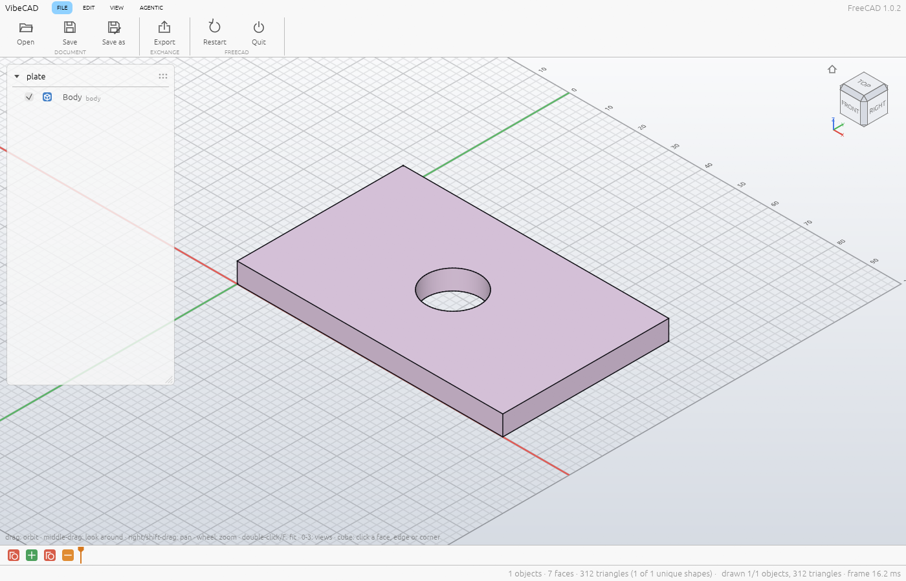

# VibeCAD

[](https://github.com/RawMechatronicsOrg/VibeCAD/actions/workflows/build.yml)
[](https://github.com/RawMechatronicsOrg/VibeCAD/releases/latest)
[](LICENSE)

**A better window on FreeCAD, for you and for your agent.**

VibeCAD is a front end to FreeCAD, not a fork of its modelling core and not a new file format.
FreeCAD runs headless in its own process and does all the modelling; VibeCAD draws its shapes
with wgpu and edits its documents through it. Documents stay ordinary `.FCStd` files that
FreeCAD opens as before, colours included, so the two can be used side by side and nothing
has to be converted, in either direction.

**[Download for Windows](https://github.com/RawMechatronicsOrg/VibeCAD/releases/latest/download/vibecad-windows-x86_64.zip)** ·
**[Download for Linux](https://github.com/RawMechatronicsOrg/VibeCAD/releases/latest/download/vibecad-linux-x86_64.tar.gz)** ·
[All releases](https://github.com/RawMechatronicsOrg/VibeCAD/releases)



## What you get

For you:

- **The layout of the big CAD tools.** A ribbon, the 3D view filling the window, the model tree
  and the properties floating over it, a view cube, and a timeline of what each body is built
  from, with a rollback marker to drag.
- **Sketching in place, as in Fusion.** Draw, constrain and dimension on a face or a plane;
  FreeCAD's Sketcher solves.
- **Direct handles.** Push or pull a face by its arrow, drag a fillet's radius, pick edges; what
  an extrude would add shows in blue, what it would cut in red.
- **Native FreeCAD objects.** Sketch, plane, extrude, fillet, chamfer, mirror, patterns and
  copies are made as the Pads, Pockets and PartDesign features FreeCAD knows.
- **Checks that point at the mistake.** The validators list thin walls, slits, steps and other
  places too small to be meant, show each in the view, and name the feature and the sketch to
  mend.
- **Large assemblies that open at once.** Boxes first, then the meshes, tessellated by several
  processes and kept in a disk cache.

For your agent:

- **An MCP server built in.** `vibecad --mcp` connects Claude Code, or any other MCP client, to
  the document open in the window: the agent edits what you see, and you see what it edits.
- **Tools to model with.** Read the tree, the properties and the sketches; draw and constrain
  sketches, extrude them, set properties and expressions; undo, redo, save.
- **Tools to check its own work.** Every edit leaves a state. `diff` gives the exact solids
  added and removed between two states, `slice` cuts the bodies like an MRI and returns
  pictures, `validate` finds the places too small to be meant, and a dry run tries an edit
  without making it.
- **You stay in charge.** The AGENTIC tab shows every call as it happens, with its pictures;
  pause the agent or leave it a note there.

It is a prototype: see [Limits](#limits) for what is missing.

## Install

1. Install [FreeCAD](https://www.freecad.org/downloads.php) 1.0 or newer. VibeCAD uses it and
   does not come with it.
2. Download the archive for your system (above), unpack it and start `vibecad`. To see a model
   at once, give it the sample: `vibecad examples/plate.FCStd`.

On Windows the program is not signed, so SmartScreen asks before its first start (More info →
Run anyway). The Linux build needs glibc 2.35 or newer (Ubuntu 22.04, Debian 12, Fedora 36) and
a Vulkan driver.

VibeCAD looks for FreeCAD's console (`freecadcmd`) in `C:\Program Files\FreeCAD*\bin`, in
`/Applications/FreeCAD.app` on macOS, then on `PATH`. Set `VIBECAD_FREECAD_CMD` to its full path
if it is elsewhere.

`examples/plate.FCStd` is a PartDesign body: a constrained sketch, a pad and a pocket. Select
`Pad` in the tree and change `Length` to see the model recompute.

## Connect your agent

With a document open in the window, add VibeCAD to your agent once. For Claude Code (AGENTIC →
Copy setup puts this command, with the right path, on the clipboard):

```
claude mcp add vibecad -- "C:\path\to\vibecad.exe" --mcp
```

Then ask it for a change to the model. [Agents (MCP)](#agents-mcp) lists the tools.

## Updates

On start VibeCAD asks GitHub once whether there is a newer release. If there is, the status
line says so with a link to its downloads; nothing is downloaded or installed by itself, and a
failed check is silent. Set `VIBECAD_NO_UPDATE_CHECK` to turn the check off.

## Build from source

Needs Rust (1.88 or newer) and FreeCAD, as above.

```
cargo run --release -- examples/plate.FCStd
```

Rebuild the sample with `freecadcmd examples/make_sample.py` from the repository root.

Every push to `main` or `development` and every pull request is tested and built for Windows
and Linux by `.github/workflows/build.yml`. To
publish a release, set the version in `Cargo.toml`, then tag that commit `v` plus the version
and push the tag: the workflow attaches both archives to a new GitHub release, and running
copies of VibeCAD offer it on their next start.

```
git tag v0.2.0
git push origin v0.2.0
```

## The window

The window follows the layout of the big CAD tools: a ribbon on top (FILE, EDIT, VIEW), the 3D
view under it filling the window, the model tree and the properties of the selected object as
translucent panels floating over the view (fold them by their header), and a view cube in the
top-right corner. Click a face of the cube for that view, an edge or a corner for the views in
between, drag it to orbit; the house next to it goes back to the isometric view.

As in Fusion, the tree lists parts only; what a PartDesign body is built from (sketches, pads,
pockets, fillets, patterns) is on the timeline along the bottom, in the order it is built, each
sketch just before the feature made from it. Click a step to select it. The orange rollback
marker sits after the body's tip, the feature whose shape is the body's: drag it back to see the
body as it was at an earlier step (the steps after it fade), and forward again. That is FreeCAD's
Set tip, so it is undone with Undo and saved with the document.

The view has a light background and a ground grid on the XY plane through the origin, as in
Fusion: minor and major lines (steps of 1, 2, 2.5 or 5 × 10^n mm; a major cell of about 90 pixels,
so the lines and their labels get finer as you zoom in),
the X axis red and the Y axis green, and the distance from the origin along the two far edges.
Labels are left out where the ground is seen too edge-on to read. Parts hide the grid; the
labels are drawn over the view and are not hidden by parts yet.
VIEW → DISPLAY → Grid switches it. VIEW → DISPLAY also switches the palette (objects that only have FreeCAD's
default grey get a muted colour each, by their name; off: the document's colours only). The
EDGE WIDTH slider sets the edge width from 1 to 4 pixels (default 1.5).

| Input | Does |
| --- | --- |
| drag | orbit |
| right or middle drag, shift + drag | pan |
| wheel | zoom |
| click | select the edge near the cursor, else the face under it (and its object) |
| double click, `F` | fit all |
| `0` `1` `2` `3` | isometric (from the front-right), front, top, right |
| `O` | orthographic / perspective |
| Ctrl+O, Ctrl+S, Ctrl+Shift+S, Ctrl+E | open, save, save as, export |
| Ctrl+Z, Ctrl+Y | undo, redo |
| Esc | close the open command, else clear the selection |
| Del | delete the selected object |

## Modelling

EDIT holds the operations. Each opens a dialog where the properties are; it starts from what is
selected, and while it is open a click in the view or the tree fills its lit field (the part, or
a face or plane). OK makes one undoable step; the new object is selected, so its numbers can be
changed in the property panel afterwards. Everything made is a native FreeCAD object, so FreeCAD
opens the document as before.

| Command | Takes | Makes |
| --- | --- | --- |
| Sketch | a flat face, a construction plane or XY/XZ/YZ (picking it starts the sketch) | `Sketcher::SketchObject` attached to it, open in sketch mode |
| Plane | a flat face, a construction plane or XY/XZ/YZ; offset, angle | `PartDesign::Plane` attached to it |
| Extrude | a flat face (or a sketch from the tree); distance (drag the arrow), both sides | `Pad` (positive) or `Pocket` (negative) |
| Fillet, Chamfer | edges of one part (a face stands for all its edges); radius or size (drag the arrow) | `PartDesign::Fillet` / `Chamfer` |
| Mirror | a part, a plane; new solid or join | `Part::Mirroring`, or `PartDesign::Mirrored` of the whole body |
| Circular | a part, X/Y/Z or a round face (its axis); count, angle | `PartDesign::PolarPattern` of the whole body |
| Linear | a part, X/Y/Z or a flat face (its normal); count, spacing | `PartDesign::LinearPattern` of the whole body |
| Copy | a part; move X/Y/Z, linked | an independent copy, or an `App::Link` |
| Delete | the selection | removes it; refused while another object uses it |

- A feature goes after its body's tip and becomes the tip; only the tip of a body is drawn, as in
  FreeCAD. Patterns and joined mirrors work on the whole body, which may then hold several solids.
- A plain solid (a Part feature, an imported shape, a mirror image) that gets a PartDesign
  feature first becomes the base of a new body, as FreeCAD's "body from a solid" does; its face
  numbers stay the same. A link shows another part, so it is mirrored and copied, not changed.
- A step whose result fails to compute, or leaves no solid, is undone at once and its error is
  shown; nothing half-made stays in the document.
- Construction planes are drawn as translucent orange squares over the model, centred where
  the model's centre falls on them, and can be clicked. A placement (a plane's
  `AttachmentOffset`, an object's `Placement`) shows as six numbers: x, y, z, yaw, pitch, roll.

**Sketch mode.** Create sketch (EDIT → CREATE → Sketch), or a double click on a sketch in the
timeline or the tree, opens the sketch in place: the camera turns to face it, its x to the right,
and the ribbon holds its tools instead of the tabs' buttons. Line (L) draws segments end to end
until Esc or a double click; Rectangle (R) takes two corners, Center rect the centre and a corner;
Circle (C) the centre and a point on it; Arc (A) its start, its end and a point on it; Point (P).
A click snaps to a point of the sketch or its origin within a few pixels (and is joined to it
with a coincident constraint), else lines up with the click before it (and the line gets a
horizontal or vertical constraint), else rounds to a step that follows the zoom; the shape to
come is previewed dashed with its length or size. Each finished shape is one `sketch_edit`, one
undo step, solved by FreeCAD. With no tool, a click picks elements (Ctrl or Shift adds); Del
deletes them and X makes them construction geometry (dashed orange, never part of a profile).

CONSTRAIN holds Dimension (D) and the constraints: coincident (two points, or a point onto a
curve), horizontal/vertical (a line or two points, whichever it is nearer), parallel,
perpendicular, tangent, equal, midpoint, concentric and fix. A constraint tool takes clicks on
points and elements (points win within a few pixels) and adds the constraint once it has what it
needs; elements picked before the tool apply at once. Dimension takes a line (its length), a
circle (diameter), an arc (radius), two points, a point and a line, or two lines (their angle, or
their distance when parallel), and opens a box by the pointer with the value it measures: type
the value, Enter. Dimensions are drawn by what they measure, the other constraints as small
marks (H, V, //, ...); a click picks one (Del removes it) and a double click on a dimension opens
its value. With no tool, a point or a line can be dragged: while the pointer moves, dry runs show
where the solver puts everything, and the release makes one move (with undone steps waiting for
redo, which a dry run would drop, only the release moves it).
The sketch is drawn over the view from the worker's description: blue while it can still move,
black once fully constrained; its closed profiles are shaded orange (triangulated by the worker).
A panel where the properties stand shows its elements, constraints, degrees of freedom and
profiles. Esc drops the shape being drawn, then the tool, then the picked elements, then leaves
the sketch, as Finish sketch does; the sketch stays selected, so Extrude takes it as its profile.

**Edges and handles.** An edge under the cursor lights up light blue; a click picks it (blue), as
a face is picked. Only edges of the faces under and around the cursor count, so edges hidden
behind the part are not picked. In Fillet and Chamfer each click on an edge adds it or takes it
out again. A selected flat face carries an arrow along its normal: drag it to push or pull the
face, as Fusion's press-pull does. That opens Extrude with the distance dragged; the solid it
would add shows in blue, what it would cut in red, and OK (or Enter) makes it. The Extrude
dialog has the same arrow, and Fillet and Chamfer have one on their first edge for the radius
or size. Values snap to round steps that follow the zoom. The edges come from the worker on
demand (`edges`: per edge its polyline, the faces it bounds and the way out of its corner), the
face from `face` (its triangles, centre and outward normal), and are kept until the model
changes.

Typed numbers apply on Enter or when the field loses focus. Opening another file or closing the
window asks before unsaved edits are lost. If FreeCAD crashes, File → Restart FreeCAD starts a new
one and reopens the file.

## Validators

EDIT → INSPECT → Check opens a panel that lists what the validators find in the model, worst
first, and keeps it up to date: while it is open the check runs again after every change (not
while a sketch is drawn), so a place that was mended leaves the list. Every place has a dot in
the view. A click on a row turns the view to the place and draws its box; a second click goes
close. The row says how small it is, what it is and in which part; picked, it says which faces
and edges, and the feature at which the place first shows, with the sketch that feature is
built from: that is where to mend it. "Smaller than" sets what counts as too small (left alone:
0.1 mm, or a thousandth of the model's size if that is less). Whether the panel is open is kept
between runs, like the other switches.

The validators are a stack in the worker (`VALIDATORS` in `vibecad_worker.py`): each is a
generator that looks at one body's shape and yields findings (kind, size, where, the faces and
edges). Findings that lie together, whichever validator made them, become one place. The
first validator, `degenerate`, finds what is too small to be meant, the kind of thing several
extruded sketches leave when they miss each other by a hair:

| Kind | What |
| --- | --- |
| thin wall | two faces closer than the limit with material between them |
| narrow gap | the same with air between them: a slit, or two solids nearly touching |
| step | two faces less than the limit apart that are neither back to back nor face to face: offset, or parted by a strip (a chamfer or fillet under the limit reads so) |
| narrow face, short edge | a strip narrower, an edge shorter than the limit; a pin or hole thinner than it |
| sharp edge, sharp slit | material, or air, that thins out to nothing: faces meeting at under 10° |
| touching faces, edge of several faces | a solid that touches itself, or another solid of the body, without being joined |

It measures the exact faces (OCCT's distance between two faces, the surfaces' normals), so a
sliver of a hundredth of a millimetre is found as surely as a large one; nothing is sampled.
Faces are paired by their boxes first: a plate with 900 holes took 0.6 s. Findings are joined into a
place by the distance between their shapes, not by their boxes, so a part that lies askew gives
the same places. The feature a place is "since" is found by running the same check on the
shapes of the body's features, halving between the first and the tip (which takes a place that
is there at a feature to stay to the tip); a place has no "since" when the time ran out or a
feature on the way could not be checked whole.

## How it works

```
 vibecad (Rust: eframe/egui + wgpu)          freecadcmd + worker/vibecad_worker.py
 ┌───────────────────────────────┐  TCP     ┌──────────────────────────────────────┐
 │ tree · properties · 3D view   │ 127.0.0.1│ FreeCAD App layer: Document, Part,   │
 │ scene.rs: split per face,     │◄────────►│ PartDesign, Sketcher, OCCT           │
 │   instances, feature edges    │  frames  │ MeshPart tessellation, cached per    │
 │ render.rs: MSAA view, face ids│          │ shape; GuiDocument.xml read/restored │
 └───────────────────────────────┘          └──────────────────────────────────────┘
```

- **Worker.** `src/worker.rs` writes the embedded `vibecad_worker.py` into a new private
  directory, listens on a free localhost port and starts `freecadcmd` with `VIBECAD_ADDR` and a
  random `VIBECAD_TOKEN`; the script connects back and must greet with the token. The listener
  closes after that one connection, and the directory is removed once FreeCAD has read the script. Every message is a JSON header plus an optional binary payload, both
  length-prefixed (see the script's docstring). Commands: `open`, `new`, `tree`, `props`,
  `set_prop`, `set_props`, `script`, `sketch`, `new_sketch`, `sketch_edit`, `set_visible`, `set_tip`, `undo`, `redo`, `scene`, `save_as`, `export`, the modelling
  ones (`datum_plane`, `extrude`, `fillet`, `mirror`, `pattern`, `copy`, `delete`), `edges`
  and `face` for picking edges and drawing handles, and the agent's (`snapshot`, `timeline`,
  `slice`, `diff`), and `validate`. Requests go out as
  they are made; replies come back in order, a scene's stream frames before its reply, except
  that `tree` and `props` asked while a scene streams are answered at once, between its frames,
  so the tree and the properties of a selected part do not wait for a large assembly to load.
  The window writes each request from a thread of its own the moment it is made, and matches
  replies to requests by id.
- **Tessellators.** The worker does not tessellate itself: it starts processes of its own
  (`VIBECAD_TESSELLATORS`; by default one per core but one, at most 4; 0 meshes in the worker), each a
  `freecadcmd` running the same script with `VIBECAD_ROLE=tessellator` and connecting back to
  the worker with a token, as the worker does to the window. A shape goes to an idle one as
  BREP text (`exportBrepToString`) with the tolerance, and its mesh comes back in the same
  format as the scene's. Faces keep their order through BREP, so face numbers, colours and
  picking are unchanged; OCCT may split a face along the other diagonal or add a point or two
  on a curved one, within the tolerance. A crash in OCCT costs a process, which is started
  again, not the document: the shape is tried once more, and one that stops a second
  tessellator is reported in `skipped` and not meshed again in that session. On Windows the
  tessellators sit in a job object that ends them with the worker, even when the window kills
  it; elsewhere they end once the worker's connection closes, after the shape they are on. On
  `open` and `new` the shapes still being meshed for the old document are dropped. If no
  tessellator can be started (`freecadcmd` unknown: the window passes its path in
  `VIBECAD_FREECAD_CMD`) the worker meshes itself, as before. The scene's `stats` say how many
  tessellators there were and how many meshes they made (`pooled`).
- **Scene.** The worker tessellates each distinct shape once (`MeshPart.meshFromShape` with one
  segment per face) and sends instances that place it, so the 265 links of an assembly with 121
  parts cost 121 meshes. Curves are cut into segments of at most 10° (0.17 rad), so circles are round on screen.
  Edges are taken from the mesh, so they lie exactly on the triangles: where a curved face meets
  another (a cylinder's rims, a fillet's borders), where flat faces fold by more than 40°, and
  where they fold by 25-40° in a line that carries on a drawn edge (hysteresis). The facets of a
  solid sewn from a mesh (a cable, a bought screw) show no seams, and their normals are smoothed
  where triangles turn by less than 40°, so they shade round. Shapes without faces (sketches)
  bring their B-rep edges.
- **Loading in stages.** `scene` streams: first, before any tessellation, every instance's
  placement, colours and its shape's box (FreeCAD's `BoundBox`); the window draws those as
  translucent boxes and fits the view, so the tree, selection and orbiting work at once. Then
  the meshes, handed to the tessellators biggest box first and sent as they finish, in batches
  about every 0.3 s; each batch is uploaded as its
  own chunk of GPU buffers and replaces its boxes, and faces are numbered in arrival order, so
  picking, highlight and culling work on a partial scene. Progress frames count faces, not
  objects; the view shows a bar with the percentage, the part being tessellated and the time
  left. After an edit the old scene stays until the new one's first meshes arrive. A request
  that changes the scene (`scene`, `open`, `set_prop`, `undo`, …) arriving mid-stream ends the
  stream (the worker looks between two meshes, and at least every 0.3 s while it waits for the
  tessellators) and the window ignores what was left of it. Shapes already handed out are
  meshed to the end and go to the caches; the next scene waits for those it still needs instead
  of meshing them again, so an edit during a load costs little.
- **Mesh caches.** In memory by shape hash, so after an edit only changed shapes are
  tessellated again. On disk in `%LOCALAPPDATA%\VibeCAD\cache` (`$XDG_CACHE_HOME/vibecad`,
  `~/Library/Caches/VibeCAD`; `VIBECAD_CACHE_DIR` overrides), keyed by the SHA-256 of the
  `.FCStd` file the shape comes from, the object's name, the tolerance, FreeCAD's version and a
  cache version. A document edited in this session (`set_prop`, undo, redo) uses no disk entry
  until it is saved, so an edited shape is never served from a stale one (the key is taken when
  a shape is handed out, so a save or an undo while it is meshed cannot misfile it). Entries past 1 GB are
  dropped, least recently used first. Hashing each shape's BREP instead was measured and
  rejected: 3 s and 76 MB of strings for the Orbiter assembly, against 13 ms for its file.
- **Drawing.** Each mesh is uploaded once (vertices split per face, so faces keep sharp normals
  and their own id), in the chunk of the batch it came in. Instances are drawn on the GPU: every frame the window tests each
  instance's box against the view, packs the visible ones (matrix, instance id, where its faces
  start in the face numbering) into an instance buffer, and draws each mesh once for all its
  visible instances. Face colours sit in a storage buffer, one per face of every instance, so
  FreeCAD's per-face colours stay. The worker marks a mesh `closed` when the shape is closed
  solids and its triangles are watertight, consistently wound and enclose the solids' volume
  (so they face outward); such meshes are drawn with back faces culled, with the winding
  flipped for mirrored instances. Open shells, sketches and anything else are drawn from both
  sides. The status line shows how many objects and triangles the last frame drew.
- **Shading.** Plastic lit in linear light and written back as sRGB: a soft sky and ground, a
  headlight, a key light from above-front, a soft highlight and a faint fresnel rim, with a gentle
  shoulder so light parts do not burn out. (Lighting the sRGB values directly darkened and greyed
  every face turned from the light.) Two-sided. The view is drawn with 4x MSAA (1x where the
  GPU's formats lack it, or with `VIBECAD_NO_MSAA` set) and resolved into the texture egui shows.
  Edges are not GPU lines: each segment becomes a screen-facing quad in the vertex shader (from
  the edge points in a storage buffer), clipped at the near plane before the divide, with a soft
  falloff across its width and alpha blending; the ends reach half the width past the points so
  corners close. Faces carry a depth bias so the edges on them win; hidden edges stay hidden.
- **Picking.** Face ids are drawn in their own single-sample pass into an `R32Uint` target,
  without lighting, only when a click asks: the pass replays the last frame's camera and
  culled instances, scissored to the clicked pixel, and the pixel is read back and mapped to
  `Object.FaceN`. Edges are not drawn there, so a click on an edge picks the face under it.
- **Colours and visibility** live in `GuiDocument.xml`, which a headless FreeCAD neither reads
  nor writes. The worker reads them from the file at open and puts that file (and the colour
  files it names) back after a save, with the visibility set in VibeCAD written in, so FreeCAD
  shows the document as VibeCAD did. Objects added in VibeCAD get FreeCAD's default look.

## Agents (MCP)

An agent such as Claude Code works on the document open in the window, through an MCP server
that is VibeCAD itself started with `--mcp`. Add it once (AGENTIC → Copy setup puts this
command, with the right path, on the clipboard):

```
claude mcp add vibecad -- "C:\path\to\vibecad.exe" --mcp
```

`vibecad --mcp` speaks MCP on stdio and passes each tool call to the running window: the window
listens on a random localhost port and writes it, with a random token, to `agent.json` in
`%LOCALAPPDATA%\VibeCAD` (`~/Library/Application Support/VibeCAD`, `$XDG_RUNTIME_DIR/vibecad`),
removed when the window closes. So the agent edits and sees the same document as the person at
the screen, with one FreeCAD.

Tools: `get_status`, `get_tree`, `get_properties`, `get_sketch`, `new_sketch`, `sketch_edit`,
`extrude`, `set_property`, `set_properties`, `run_script`, `undo`, `redo`, `save`,
`open_document` (refused while there are unsaved edits), and for checking what an edit did:

- **Properties.** `get_properties` leaves out what reads as noise (shapes, materials, the raw
  expression engine); entries the tools cannot set (links, lists, vectors) are read-only, and a
  property bound to an expression carries it. A sketch's dimensions are properties too:
  `Constraints.<name>`, or `Constraints.<index>` (from 0) when unnamed, in mm or degrees; a
  reference dimension is read-only. The property panel edits them the same way.
- **`get_sketch`**: a sketch's plane, its elements in its own (x, y) (lines, circles, arcs,
  points, ellipses, B-splines; construction ones marked) and its constraints with what they
  refer to, each dimension with its value and property name.
- **`set_property` / `set_properties`**: a value, or an `expression` (`"Spreadsheet.t * 2"`;
  `""` removes it). `set_properties` makes several changes with one recompute: one undo step,
  one state. A change that is refused refuses them all; objects left invalid come back with
  FreeCAD's error. With `dry_run` the document is put back as it was (no undo step, no state on
  the timeline) and the result is kept as a trial state, `t1`, `t2`, ... (the last 20), that
  `diff` and `slice` take like any other. A dry run is refused while undone steps wait for
  redo: FreeCAD drops them as soon as any transaction opens.
- **`save`**: to the document's file, or to another absolute `.FCStd` path, which becomes its
  file; an existing file other than its own is replaced only with `overwrite`.
- **Sketching.** `new_sketch` makes an empty `Sketcher::SketchObject` on an origin plane, a
  construction plane or a flat face, attached so it follows it (in the body of the face's part;
  on an origin plane in the body named, the only body, or a new one). `sketch_edit` makes one
  undoable change to it: remove elements or constraints, add lines, circles, arcs (by centre and
  angles, or through three points), points, rectangles (by corners or centre) and polylines,
  add constraints (coincident, horizontal, vertical, parallel, perpendicular, tangent, equal,
  point on object, midpoint, symmetric, concentric, fix) and dimensions (distance, distance x/y,
  radius, diameter, angle; named ones become `Constraints.<name>` properties), switch elements
  to construction, and drag a point under the solver. FreeCAD's solver does the solving; a
  change it cannot satisfy is refused and undone. Every reply has the sketch as data (geometry,
  constraints, degrees of freedom, closed profiles) and a picture of it, profiles filled.
  `extrude` extrudes a sketch's closed profiles (a Pad, or a Pocket for a negative distance) or
  pushes or pulls a flat face. A sketch with open curves is refused until they are closed,
  construction or gone.
- **`run_script`**: Python source run inside the window's FreeCAD, for what no other tool makes
  (a surface through computed points, lofts and sweeps, shapes built in a loop) or measures. It
  is one undo step and one state, and takes `dry_run` like `set_properties`. The script sees
  `doc`, `FreeCAD` (also `App`), `Part`, `math`, `params` (the call's `params`) and
  `show(shape, name)`, which puts a shape into the document as the `Part::Feature` `name` and
  replaces that object's shape when it is there: the same code with other `params` changes
  its result, it does not add a copy. Back come what it printed, its variable `result`, the
  objects it created and removed, and the states to `diff` and `slice`. A script that raises
  leaves the document as it was, and the error names its line; so does one still running after
  5 minutes, stopped between two Python instructions (a single call into OCCT runs to its
  end). A script that changed nothing leaves no undo step, keeps the steps redo can bring
  back, and leaves the document unmodified. The
  script is not kept in the document: what stays are ordinary FreeCAD objects.

  ```python
  # params: {"n": 12, "size": 60, "height": 4}
  n, size, h = params["n"], params["size"], params["height"]
  pts = [[App.Vector(size * i / n, size * j / n, 10 + h * math.sin(4 * i / n) * math.cos(4 * j / n))
          for j in range(n + 1)] for i in range(n + 1)]
  top = Part.BSplineSurface()
  top.interpolate(pts)
  show(top.toShape().extrude(App.Vector(0, 0, -50)).common(Part.makeBox(size, size, 50)), "Wave")
  ```

  The script runs with the rights of the person's FreeCAD: it can read and write files and
  start programs. Only a client that holds the token in `agent.json` (readable by this user
  only) can send one, each call shows in the feed with its code, and Pause refuses them.

- **States and timelines.** The worker keeps the exact shape of every solid body (a PartDesign
  Body, or any solid no other shape takes as input) at each state: `s0` at open, one after
  every edit that changed a shape (`set_property(ies)`, undo, redo; also edits made by hand), and
  one per `snapshot`. `get_timeline` lists, per body, the states at which it changed, with its
  volume and the change of volume. `set_property` returns `state_before` and `state_after`.
- **`slice`**: cuts of the bodies by parallel planes along x, y, z or any normal, at given
  offsets or spread evenly, like the slices of an MRI. The agent gets a picture of all cuts at
  one scale, and per cut its regions with area, centre, box and holes (circular ones with their
  diameter and centre). Given an earlier state, each cut is split exactly (2D booleans) into
  what both states have (grey), what was added (green) and what was removed (red).
- **`diff`**: per body, the exact added and removed solids between two states (3D booleans),
  each with its volume, box, centre, a shape guess (box, cylinder) and its faces by surface
  (plane normal and offset, cylinder radius and axis, cone, sphere, torus); and a picture of
  three cuts through the changed region, one per axis, each at its own scale.
- **`validate`**: the places the validators find (see Validators), worst first: kind, size or
  angle, what it is in words, a point, the box, the faces and edges, and `since`, the feature
  and sketches that made it. The first four come with a picture, a cut through a small box
  around each (`view_box`), across the wall, gap or step. `slice` takes such a box as `box`
  and cuts only what lies in it, at the box's scale, for a look from another side or a
  comparison with an earlier state. `min_size` and `min_angle` say what is too small; `state`
  checks an earlier or a trial state (without `since`).

The AGENTIC tab shows a feed of the agent's calls as they happen: arguments, time taken,
result, and the pictures the agent got. **Pause** makes the window refuse the agent's calls
(it is told the person paused it) until clicked again; a **note** typed in the feed goes out
with the agent's next tool result.

## Tests

```
cargo test                                         # scene decoding, the camera, the shader (naga)
python worker/test_worker.py examples/plate.FCStd  # the worker protocol, against a real FreeCAD
python worker/test_modelling.py                    # the modelling commands, against a real FreeCAD
python worker/test_sketch.py                       # sketches: make, draw, constrain, drag, extrude
python worker/test_validate.py                     # validators: a plate with a step, a thin wall, a slit, sharp edges
python worker/test_mcp.py                          # MCP end to end: opens the window, drives it, closes it
```

`test_modelling.py` runs every modelling command on the example plate and checks what is drawn
and where (planes on faces and origin planes, extrude both ways, fillet, chamfer, mirror three
ways, patterns about an axis and a hole, copies, deletes), that refused and failed steps leave
nothing behind, and undoes each step.

`test_worker.py` gives the worker an empty disk cache, checks the scene stream (boxes first,
progress in faces, each mesh once, biggest first when nothing was tessellated), that a `tree`
sent during a scene longer than a second is answered before it, opens every file again in a new
process to check that all meshes come from the disk cache, that an edited shape does not, and
that a second `scene` sent mid-stream ends the first. On the sample it runs scripts: a wavy
block made, changed by the same script with other params, tried dry and undone; one that only
measures; and ones that raise, exit, never end or have a syntax error, which must leave the
document and its undo history as they were. Last it loads every file twice more from
an empty cache, meshed in the worker (`VIBECAD_TESSELLATORS=0`) and by the tessellators, and
checks that the tessellators made every mesh and that the meshes agree: the same faces and
flags, triangle counts within 1 %, the same box within the tolerance. Give it a large assembly
too, so the tessellators run in parallel:

```
python worker/test_worker.py examples/plate.FCStd path/to/assembly.FCStd
```

`VIBECAD_SELFTEST=<dir> vibecad examples/plate.FCStd` drives the window itself: it keeps a frame
of the boxes and one of a partly loaded scene while the document streams in, zooms in and back,
picks faces (a grid of points and two inside the first object's box), selects `Pad`, sets
`Length` to 12, undoes, extrudes the top face and puts a construction plane over it through the
modelling commands, writes frames as BMP and `report.json` to `<dir>`, and quits. The
report's `load` entry is the timeline of the first scene (boxes, first meshes, all meshes, in
ms after the request, and the worker's cache hits); `perf` gives the GPU memory of the scene,
the time to decode and upload it, the objects and triangles drawn and the time per frame (30
frames drawn and waited for) for the fitted and the zoomed view. It also runs on other
documents, where the `Pad` steps just report an error.

## Limits

- The `degenerate` validator does not find a wall or a gap between two faces that share a
  corner (away from the edge they meet at), a face that comes close to itself unless it is round
  (a pin, a hole), or a strip that is narrow at one spot only. It checks each body on its own:
  two bodies that nearly touch or overlap are not compared. A body of more than 20 000 faces (a
  solid sewn from a mesh) is skipped unless named. A check holds the worker for up to 10 s from
  the window (30 s from an agent, or what it asks); what it did not finish is said, not hidden.
  The places are drawn over the view without depth, and a place does not select its faces.
- No sketcher, and a construction plane cannot be put on an edge. Properties of type length,
  angle, number, integer, bool, string, enumeration and placement are editable; others are shown
  as text.
- Construction planes, picked edges, handles and the extrude preview are drawn over the view
  without depth, so they show through parts in front of them. There is no preview of a fillet.
- Lighting edges under the cursor picks the scene once per resting position; on a scene where
  that takes over 15 ms it is turned off for the session (clicks still pick edges).
- The first view of a large assembly takes time: the 158 000-face Orbiter assembly shows its
  boxes 0.5 s after it is open, its first mesh after 2.3 s and all of it after about 19 s
  (some 3 s of that checking which shapes are closed solids); from the disk cache all of it
  takes 0.6 s. OCCT meshes each shape on one thread: `MeshPart` has no parallel option, and
  four Python threads saved only 17 % (9.6 s instead of 11.5 s for the meshing alone), hence
  processes. On the Orbiter assembly as it is now (51 distinct shapes, 93 500 faces, 16 cores)
  a cold load took 12.8 s meshed in the worker, 7.5 s with 2 tessellators, 4.5 s with 4 and 4.0 s
  with 8; past 4 the biggest parts set the pace. Writing the shapes as BREP costs the worker
  about 1.8 s of that, spread over the load. Each tessellator is a FreeCAD of about 70 MB, and
  the first scene after start waits for them to connect (some 0.1 s). A shape on which OCCT
  hangs keeps its tessellator, and the scene waits for it, without a time limit.
- Boxes are FreeCAD's bounding boxes, which for some curved shapes are much larger than the
  shape; they are only a placeholder until the mesh arrives.
- Meshes share one vertex, one index and one edge buffer per batch. The window asks the GPU
  for its full buffer size and refuses a batch that does not fit, with a message; links to
  the same part cost no extra GPU memory. Culling works per object: a single huge part in
  view is drawn whole, and nothing hidden behind other parts is skipped.
- The view reads face colours from a storage buffer in the vertex shader, which OpenGL-level
  backends lack; on a machine where wgpu falls back to OpenGL the view stays empty with a
  message. With back faces culled, a perspective view whose near plane cuts a closed solid
  shows through it rather than its inner walls. A curved part whose tessellated volume is off
  from the solid's by more than 2 % is drawn from both sides (correct, only slower).
- Each edit reloads the tree and the scene; quick edits in a row are not merged.
- A link to a whole sub-assembly (`App::Part`) is drawn, but tessellated again on every reload.
- The tree and the timeline follow `Group`; a sketch no feature uses stays where it is in its
  body's order. The rollback marker stops only after features that make a shape (not after a
  sketch or a datum).
- Run on Windows only so far; the Linux build is compiled and tested by the workflow, not yet
  tried by hand. On Linux it needs `freecadcmd` on `PATH` (or
  `VIBECAD_FREECAD_CMD`); FreeCAD from Flatpak, Snap or an AppImage is not found yet, and the
  Flatpak and Snap sandboxes may not see the script in the temp directory. File dialogs use the
  XDG desktop portal, which must be running.
